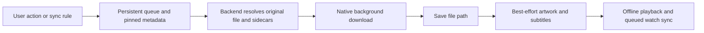

# Plezy API and download notes

Reviewed 2026-09-27 against the local `edde746/plezy` checkout at **`18642cae1517556f1b437a2f047e67bf116851f7`**, version **2.5.0+110**. This is a source review, not a live-server compatibility test. The inventory covers application network/API boundaries and platform integrations, grouping related endpoints rather than reproducing every request parameter. Current upstream `main` has additional features; do not infer those features from this pinned review.

## Architecture and authentication

Flutter providers and services depend on a backend-neutral `MediaServerClient`. `PlexClient` and `JellyfinClient` translate requests and response DTOs into shared media, library, source, stream, and download models. `MediaServerHttpClient` supplies HTTP/error handling; platform clients use Cupertino HTTP on iOS/macOS, Cronet on Android, WinHTTP on Windows, and Dart IO on Linux/tvOS, with fallbacks. Metadata caches, the download manager, playback initialization, and offline watch synchronization remain separate services. See [client contract][contract], [HTTP transport][http], and [platform transport][platform-http].

| API / destination | Authentication and purpose |
| --- | --- |
| Plex account: `plex.tv/api/v2`, `clients.plex.tv/api/v2` | `POST /pins?strong=true`, browser authorization at `app.plex.tv/auth#?...`, then `GET /pins/{id}` until `authToken` appears. `/user`, `/home/users`, `POST /home/users/{uuid}/switch`, and `/resources?includeHttps=1&includeRelay=1&includeIPv6=1` provide account/profile/server discovery. Requests identify the app through `X-Plex-Product` and a persistent `X-Plex-Client-Identifier`; authenticated requests add `X-Plex-Token`. Resource records contain **server-specific access tokens** and local/remote/relay connection URLs. Selected clients-API GETs retry through `plex.tv` on transient failure. [Source][plex-auth] |
| Plex Media Server: discovered/user-selected origin | JSON requests use `Accept: application/json`, the token header, client/product/version/platform headers, and `X-Plex-Client-Profile-Name: Generic`. Responses generally wrap `Directory`, `Metadata`, `Hub`, etc. in `MediaContainer`. Stream/image URLs can carry `X-Plex-Token` in the query. Library/item IDs are server-scoped. [Configuration][plex-config] |
| Jellyfin: configured server origin | Username/password via `POST /Users/AuthenticateByName`, or Quick Connect (`/QuickConnect/Enabled`, `/Initiate`, `/Connect`, then `/Users/AuthenticateWithQuickConnect`). `/System/Info/Public` probes identity, `/Users/Me` validates the session, and `POST /Sessions/Logout` signs out. API headers include `Authorization: MediaBrowser ... Token="…"`, `X-Emby-Token`, JSON Accept/Content-Type; media URLs use `api_key`. LAN discovery broadcasts on UDP **7359**. [Auth][jf-auth], [client][jf-client], [discovery][jf-discovery] |

Plex connection selection probes published endpoints and supports failover for suitable GET failures. JSON fields sometimes arrive as strings, numbers, or booleans; the mappers normalize these. Plezy persists account/session state through its preferences/connection storage and redacts tokens from logs. A new native client should own its credential storage and avoid putting token-bearing URLs in diagnostics or persistent cache keys.

## Media-server API inventory

Paths below are relative to the selected server unless a host is shown. `{id}` placeholders are opaque identifiers, not filesystem paths.

| Plex family | Paths and operations used |
| --- | --- |
| Server/discovery | `GET /`, `/identity`, `/media/providers`, `/:/prefs`, `/activities`; cancel with `DELETE /activities/{uuid}`. Providers expose shared libraries and dynamic hub/EPG keys. |
| Browse/search | `/library/sections`, `/library/sections/{id}/all`, `/library/shared/all`, `/library/search`, `/library/recentlyAdded`, `/library/metadata/{id}`, `.../children`, `.../grandchildren`, `.../extras`, `/library/people/{id}/media`; folder browsing follows `/library/sections/{id}/folder` and returned folder keys. |
| Filters/hubs | Section `prefs`, `filters`, `sorts`, `firstCharacter`, and returned filter-value keys; `/hubs`, `/hubs/sections/{id}`, `/hubs/metadata/{id}/related`, plus provider-advertised hub keys. Paging uses `X-Plex-Container-Start` / `X-Plex-Container-Size` with response totals. |
| Watch state/rating | `GET /:/scrobble`, `GET /:/unscrobble`, `POST /:/timeline`, `/:/rate`, `PUT /actions/removeFromContinueWatching`. Timeline positions/durations use milliseconds. |
| Playlists/collections/queues | List/create/delete `/playlists`, get `/playlists/{id}`, add/remove/move `/playlists/{id}/items...`; section collections and `/library/collections/{id}/children`, create/delete collections and mutate their items; `POST /playQueues`, `GET /playQueues/{id}`. Queue/playlist creation uses `server://{machineIdentifier}/com.plexapp.plugins.library/...` URIs. |
| Metadata/library maintenance | Edit via `PUT /library/sections/{id}/all`; item `prefs`, `matches`, `match`, `unmatch`, image-list/image-selection paths, image upload, item deletion; section `refresh`, `refresh?force=1`, `analyze`, `emptyTrash`. These are server mutations. |
| Media/subtitles/artwork | Original files follow returned `Media[].Part[].key`; stream selection uses `PUT /library/parts/{id}`. Subtitle search/add uses `GET`/`PUT /library/metadata/{id}/subtitles` (Plex contacts the subtitle provider). External tracks follow returned `Stream.key`; BIF previews use `/library/parts/{id}/indexes/sd`; artwork/chapter images use returned paths and `/photo/:/transcode`. |
| Playback transcode | `/video/:/transcode/universal/decision`, then `/video/:/transcode/universal/start` with media/part indexes, session identifiers, quality and client-profile parameters. The VOD target is HTTP/MKV. This path is separate from offline downloads. |
| Live TV/DVR | `/livetv/dvrs...` for DVR creation/deletion, preferences, devices, lineups, guide reload and channel tune; `/media/grabbers...` for tuner discovery, devices, scan, channel maps/preferences and operations; `/livetv/epg...` plus provider-advertised grids/discover hubs and lineup channels; `/media/subscriptions...` for recording rules, ordering, processing/schedules; `/media/providers...` for provider management/mapping; `/livetv/sessions...`, live timelines and transcode URLs. |
| Notifications/cloud favorites | Builders for `/:/websocket/notifications` and `/:/eventsource/notifications`; favorite channels are GET/PUT at `https://epg.provider.plex.tv/settings/favoriteChannels` with `X-Plex-Provider-Version: 5.1`. |

The Plex inventory comes from [PlexClient][plex-client] and its [Live TV implementation][plex-live]. Dynamic paths returned by the server are part of the contract; a hardcoded path list alone cannot represent every possible request. Plex also publishes a [Media Server API reference](https://developer.plex.tv/).

| Jellyfin family | Paths and operations used |
| --- | --- |
| Libraries/items | `/Users/{userId}/Views`, `/Items` with parent/type/search/sort/filter/recursive and `StartIndex`/`Limit`, `/Items/Filters`, `/Users/{userId}/Items/{id}`, `/Shows/{id}/Seasons`, `/Shows/{id}/Episodes`; latest, `/UserItems/Resume`, `/Shows/NextUp`, similar items, local trailers and special features. |
| Playback/images/subtitles | `POST /Items/{id}/PlaybackInfo` with a device profile negotiates `MediaSources`, stream indexes and `PlaySessionId`; use returned transcode URLs for playback, `/Videos/{id}/stream[.{container}]?Static=true` for original files, returned subtitle delivery URLs or `/Videos/{id}/{sourceId}/Subtitles/{index}/Stream.{codec}`, `/Items/{id}/Images/...`, `/Videos/{id}/Trickplay/...`, and `/MediaSegments/{id}`. |
| Progress/favorites | `POST /Sessions/Playing`, `/Sessions/Playing/Progress`, `/Sessions/Playing/Stopped`; POST/DELETE `/UserPlayedItems/{id}`, `/UserItems/{id}/Rating`, and `/Users/{userId}/FavoriteItems/{id}`. Jellyfin playback times use 100 ns ticks. |
| Lists/maintenance | Create/mutate `/Playlists...` and `/Collections...`; delete via `/Items/{id}`; refresh, metadata edit, image listing, remote-image download, and image upload below `/Items/{id}`. |
| Live TV | `/LiveTv/Channels`, `/LiveTv/Programs`; playback through the normal source negotiation/stream path. |

See the pinned [Jellyfin client parts][jf-parts]. Capabilities differ: the common interface does not mean every backend implements every Plex operation.

## Other external APIs and platform integrations

| Boundary | What this revision uses |
| --- | --- |
| Trakt (`api.trakt.tv`) | Device OAuth `/oauth/device/code`, `/oauth/device/token`, token refresh/revoke; `/users/settings`, `/scrobble/{start,pause,stop}`, history add/remove, ratings get/add/remove under `/sync`. API-version/key headers plus OAuth bearer token. [Client][trakt] |
| MyAnimeList (`api.myanimelist.net/v2`) | `/users/@me`, `/anime/{id}` episode/list-status reads, PUT/DELETE `/anime/{id}/my_list_status`; updates are form encoded. Initial OAuth uses the Plezy proxy; refresh calls `myanimelist.net/v1/oauth2/token`. [Source][mal] |
| AniList (`graphql.anilist.co`) | GraphQL `Viewer`, `Media`, `MediaList`, `SaveMediaListEntry` and `DeleteMediaListEntry` for identity, episode counts, progress/status and ratings. Bearer token comes from the OAuth proxy; there is no refresh flow in this client. [Source][anilist] |
| Simkl (`api.simkl.com`) | `/oauth/pin`, `/oauth/pin/{code}`, `/users/settings`, history and ratings under `/sync`; `simkl-api-key` plus bearer token. This revision updates watched history on completion; it does not implement Trakt-style real-time scrobble endpoints. [Source][simkl] |
| Plezy OAuth/relay/poster service (`ice.plezy.app`) | `POST /auth/start`, long-poll `GET /auth/result?session=...`, browser auth completion; `/health`; WebSocket `/relay` for Watch Together room/playback messages; `POST /posters` uploads fetched poster bytes for Discord artwork. Watch Together can use a custom relay; the OAuth proxy remains tied to its default base URL. [OAuth][oauth], [relay][relay], [Discord][discord] |
| Anime identifier mappings (jsDelivr) | Download Fribb's `anime-list-mini.json` and Anime-Lists' `anime-list.xml` from their GitHub-backed CDN URLs to map anime IDs. These are data feeds, not calls to a TMDB/TVDB/IMDb API. [Mapping stores][trackers] |
| Updates/diagnostics | GitHub `repos/edde746/plezy/releases/latest`, returned release asset URLs, and jsDelivr-hosted `appcast.xml`; `auto_updater` integrates native desktop updates. Sentry Flutter reports to `bugs.plezy.app`, subject to the crash-reporting setting. [Updater][updates], [startup][main] |
| Local companion remote | UDP discovery on **48633**; host WebSocket `/ws`, preferably TCP **48632**, otherwise an assigned port. `RemoteAuthService` derives authentication/encryption material from backend identity with HKDF/HMAC/AES-GCM. This is an app-defined LAN protocol, not Plex's public remote-control protocol. [Source][remote] |
| OS/player bridges and plugins | Flutter method/event channels drive libmpv and Android ExoPlayer; PiP, HDR/display modes, external-player launch, window/foreground behavior, gamepads, media controls, Android Watch Next and tvOS Top Shelf. Apple code uses UIKit/AppKit, AVFoundation, AVKit, QuartzCore and TVServices. Supporting plugins cover `background_downloader`, SQLite/Drift, preferences, filesystem paths/pickers, Android SAF, connectivity, wakelock, device/package info and Discord RPC. [Dependencies][dependencies], [native bridge][player], [Apple implementation][apple] |

Browser links such as Liberapay donations, GitHub issues and OAuth verification pages are opened with `url_launcher`; they are not additional media backends. External subtitle providers are accessed through Plex, not through a separate client API in this revision.

## How downloads work



1. **Queue and identity.** A movie/episode download records server ID, item ID/global key, profile/client scope, chosen media index/source, priority and companion-file options in Drift/SQLite. Metadata is fetched/cached and pinned against eviction. Duplicate active/completed downloads are rejected. Sync rules expand shows/seasons or collection/playlist entries and can retain unwatched episodes. [Queue][downloads], [rules][rules]
2. **Resolve Plex originals.** Fetch `/library/metadata/{id}?includeMarkers=1&includeChapters=1&checkFiles=1&includeStreams=1`. Read `MediaContainer.Metadata[].Media[].Part[]`. Select the requested media version, falling back to an available version; choose its first playable part. `accessible != false && exists != false` defines availability, so missing flags are permissive. The URL is the returned `Part.key` under the server origin plus token. **Plezy downloads one chosen part; it does not assemble all parts of split movies.** [Resolution][plex-download], [mapper][plex-playback]
3. **Resolve Jellyfin originals.** Resolve the chosen media source and request the direct stream with `Static=true`, source ID when needed, and `api_key`. `PlaybackInfo` supplies external subtitle streams and delivery URLs. Download selection does not request a reduced-quality offline transcode. [Resolution][jf-download]
4. **Transfer.** `background_downloader` runs `DownloadTask` with pause enabled, status/progress callbacks, native Wi-Fi-only enforcement and **five native retries**. Its holding queue is configured **(1, 1, 1)** to serialize downloads. Android SAF uses `UriDownloadTask` directly into `content://` storage with pause disabled. Downloads are disabled in tvOS builds. [Manager initialization][downloads-init]
5. **Progress, retry and resume.** UI progress is streamed; database writes are debounced by two seconds. Native resume is attempted first for a paused normal task; failure, or SAF resume, starts a fresh task. Selected exhausted failures permit up to **three app retries**, 30 seconds apart; recognized DNS/connection failures and HTTP-500 text fail without that retry, and three immediate preparation failures stop queue advancement. Resumed/restarted tasks are reconciled by native task ID, so stale callbacks cannot complete a replacement download. [Retry/resume][downloads-retry]
6. **Storage.** Default roots are app Documents on mobile or Application Support on desktop, under `downloads`; writable custom paths are supported. Movies use `Movies/Title (Year)/Title (Year).ext`; episodes use `TV Shows/Show (Year)/Season XX/SXXEXX - Title.ext`. Relative paths survive changes to the app container; Android SAF stores content URIs. Centralized artwork filenames hash server identity plus the artwork key; subtitle filenames use stable stream IDs. [Storage][storage]
7. **Completion and recovery.** Saving the final video path is critical; artwork, chapter thumbnails and external subtitles are best effort. Supplement failures do not discard a successful video. Recovery reschedules killed native tasks, reconciles persisted/native task state, cleans orphaned temporary files and repairs missing companion content. [Completion][downloads-completion]
8. **Subtitle distinction.** Only external keyed Plex subtitle streams are sidecar downloads: `{Stream.key}.{extension}?encoding=utf-8&X-Plex-Token=...`. Embedded subtitles stay in the original video. Codec mappings include subrip/mov_text→srt, ass/ssa→ass, webvtt→vtt, PGS→sup and DVD subtitles→sub. Server-side online subtitle search/add is a different operation. [URL builder][subtitle-url]
9. **Offline playback and watch state.** Playback resolves stored local files and cached metadata/sidecars. When connected, local playback can still report progress; otherwise profile-scoped watch/progress actions persist and are pushed on reconnection, then current server state is pulled. Plex uses scrobble/timeline, Jellyfin uses played-item/session APIs. Actions remain queued after the sync-attempt limit rather than silently losing local progress. [Source selection][playback-source], [watch sync][watch-sync]

## Boundary for `Plex_Shared_Backend`

The companion Swift module implements a reusable Plex API foundation: injectable HTTP transport, configured server/client identity, PIN/resource discovery, Decodable response models, library/item browsing and **original-file download request planning**. A download plan is not a background downloader. Persistent queues, native background-session lifecycle, file moves/storage, progress/resume data, cache pinning, offline playback, watch reconciliation, Jellyfin, trackers and Plex transcode/DVR support belong to later work.

Keep all available parts in a multipart download plan instead of silently dropping later parts; this intentionally goes beyond Plezy's selected-part resolver. Build URLs with components, preserve reverse-proxy base paths, encode opaque path segments/query values, distinguish missing/unavailable media, and keep authentication scoped to the intended server. Plezy's upstream [license is GPL-3.0][license]; this document records protocol observations, and the Swift implementation should be written independently without copying Plezy source.

### Native implementation and use

`Sources/Plex_Shared_Backend` is a Foundation-only package product with three injectable boundaries: `PlexAccountServing`, `PlexLibraryServing`, and `PlexDownloadPlanning`. Both network services accept `PlexHTTPTransport`; the default `PlexURLSessionTransport` uses an ephemeral session and refuses cross-origin or HTTPS-to-HTTP redirects. HTTP failures expose status codes without response bodies. Callers must avoid logging credentials, request headers, or underlying transport errors that can contain request details.

The account service supports creating a strong PIN, building the browser authorization URL, checking a PIN once, and discovering server resources through `https://plex.tv/api/v2/resources`. It does not implement Plezy's clients-host retry, profile switching, connection racing, automatic polling, or credential persistence. A pending PIN has a nil `authToken`; HTTP 404/410 during checking becomes `pinExpired`. The consuming app schedules polling and cancels it when its login screen closes.

```swift
import Plex_Shared_Backend

// Persist this identifier in the consuming app and reuse it across launches.
let identity = try PlexClientIdentity(
    identifier: persistedClientID, product: "EverythingClient", version: "1", platform: "iOS"
)
let account = PlexAccountService(identity: identity)
let pin = try await account.createPIN()
let browserURL = try account.authorizationURL(code: pin.code)
// Present browserURL, then check periodically until authorized or expired.
let checkedPIN = try await account.pin(id: pin.id)
if let token = checkedPIN.authToken {
    let servers = try await account.servers(accountToken: token)
    // Let the app/user select a server and advertised connection.
    if let server = servers.first, !server.connections.isEmpty {
        let configuration = try server.configuration(connectionIndex: 0, identity: identity)
        let api = PlexAPIService(configuration: configuration)
        let libraries = try await api.libraries()
        // Use a movie/episode ratingKey returned by items/children/grandchildren.
        let plan = try await api.downloadPlan(ratingKey: selectedRatingKey)
        // Submit each part.request (and optional subtitle requests) to app-owned storage/transfer code.
    }
}
```

Selecting a resource connection uses that resource's **server token**, never the account token. The app decides which advertised connection to use and whether to allow HTTP. Original-file and subtitle requests carry credentials in headers; their URLs preserve proxy prefixes and existing server query escapes. Use the supplied requests with equivalent redirect restrictions when adding a separate background transfer session.

The planner defaults to `.allParts`, preserving server order and failing if a required part is unavailable. `.firstPlayable` explicitly opts into Plezy's one-part behavior. Invalid media indexes fall back to zero, and an unavailable selected version falls back to the first version containing a downloadable part. External keyed subtitles are planned separately from embedded tracks. Planning performs no file transfers; malformed or unsafe media/subtitle paths fail before a request is sent.

`Tests/Plex_Shared_Backend_Tests` covers authentication, discovery/token scope, library requests and decoding, proxy paths, rejected paths and redirects, cancellation, version fallback, multipart plans, and external subtitles using synthetic responses. It is included in `Tests/UnitTestPlan.xctestplan` and has a shared `Plex_Shared_Backend_Tests` Xcode scheme. These tests do not establish compatibility with a live Plex account or server.

Validated 2026-09-27 with Xcode 27: `scheme=Plex_Shared_Backend bash .github/scripts/build.sh` succeeded for the iOS Simulator; the `Plex_Shared_Backend_Tests` scheme passed **33 tests / 77 cases**, with no failures or skips, on the iPhone 18 Pro simulator running iOS 27. No live account authentication or media transfer was performed.

[contract]: https://github.com/edde746/plezy/blob/18642cae1517556f1b437a2f047e67bf116851f7/lib/media/media_server_client.dart
[http]: https://github.com/edde746/plezy/blob/18642cae1517556f1b437a2f047e67bf116851f7/lib/utils/media_server_http_client.dart
[platform-http]: https://github.com/edde746/plezy/blob/18642cae1517556f1b437a2f047e67bf116851f7/lib/utils/platform_http_client_io.dart#L35
[plex-auth]: https://github.com/edde746/plezy/blob/18642cae1517556f1b437a2f047e67bf116851f7/lib/services/plex_auth_service.dart#L85
[plex-config]: https://github.com/edde746/plezy/blob/18642cae1517556f1b437a2f047e67bf116851f7/lib/models/plex/plex_config.dart#L53
[plex-client]: https://github.com/edde746/plezy/blob/18642cae1517556f1b437a2f047e67bf116851f7/lib/services/plex_client.dart#L472
[plex-live]: https://github.com/edde746/plezy/blob/18642cae1517556f1b437a2f047e67bf116851f7/lib/services/plex_client/parts/live_tv.dart
[jf-auth]: https://github.com/edde746/plezy/blob/18642cae1517556f1b437a2f047e67bf116851f7/lib/services/jellyfin_auth_service.dart#L92
[jf-client]: https://github.com/edde746/plezy/blob/18642cae1517556f1b437a2f047e67bf116851f7/lib/services/jellyfin_client.dart#L123
[jf-discovery]: https://github.com/edde746/plezy/blob/18642cae1517556f1b437a2f047e67bf116851f7/lib/services/jellyfin_lan_discovery_service.dart#L17
[jf-parts]: https://github.com/edde746/plezy/tree/18642cae1517556f1b437a2f047e67bf116851f7/lib/services/jellyfin_client/parts
[trakt]: https://github.com/edde746/plezy/blob/18642cae1517556f1b437a2f047e67bf116851f7/lib/services/trakt/trakt_client.dart#L42
[mal]: https://github.com/edde746/plezy/tree/18642cae1517556f1b437a2f047e67bf116851f7/lib/services/trackers/mal
[anilist]: https://github.com/edde746/plezy/blob/18642cae1517556f1b437a2f047e67bf116851f7/lib/services/trackers/anilist/anilist_client.dart#L34
[simkl]: https://github.com/edde746/plezy/tree/18642cae1517556f1b437a2f047e67bf116851f7/lib/services/trackers/simkl
[trackers]: https://github.com/edde746/plezy/tree/18642cae1517556f1b437a2f047e67bf116851f7/lib/services/trackers
[oauth]: https://github.com/edde746/plezy/blob/18642cae1517556f1b437a2f047e67bf116851f7/lib/services/trackers/oauth_proxy_client.dart#L13
[relay]: https://github.com/edde746/plezy/blob/18642cae1517556f1b437a2f047e67bf116851f7/lib/watch_together/services/watch_together_peer_service.dart#L17
[discord]: https://github.com/edde746/plezy/blob/18642cae1517556f1b437a2f047e67bf116851f7/lib/services/discord_rpc_service.dart#L288
[updates]: https://github.com/edde746/plezy/blob/18642cae1517556f1b437a2f047e67bf116851f7/lib/services/update_service.dart
[main]: https://github.com/edde746/plezy/blob/18642cae1517556f1b437a2f047e67bf116851f7/lib/main.dart#L133
[remote]: https://github.com/edde746/plezy/tree/18642cae1517556f1b437a2f047e67bf116851f7/lib/services/companion_remote
[dependencies]: https://github.com/edde746/plezy/blob/18642cae1517556f1b437a2f047e67bf116851f7/pubspec.yaml
[player]: https://github.com/edde746/plezy/tree/18642cae1517556f1b437a2f047e67bf116851f7/lib/mpv/player
[apple]: https://github.com/edde746/plezy/blob/18642cae1517556f1b437a2f047e67bf116851f7/shared/apple/MpvPlayer/MpvPlayerCoreBase.swift
[downloads]: https://github.com/edde746/plezy/blob/18642cae1517556f1b437a2f047e67bf116851f7/lib/services/download_manager_service.dart#L990
[downloads-init]: https://github.com/edde746/plezy/blob/18642cae1517556f1b437a2f047e67bf116851f7/lib/services/download_manager_service.dart#L413
[downloads-retry]: https://github.com/edde746/plezy/blob/18642cae1517556f1b437a2f047e67bf116851f7/lib/services/download_manager_service.dart#L1572
[downloads-completion]: https://github.com/edde746/plezy/blob/18642cae1517556f1b437a2f047e67bf116851f7/lib/services/download_manager_service.dart#L1691
[plex-download]: https://github.com/edde746/plezy/blob/18642cae1517556f1b437a2f047e67bf116851f7/lib/services/plex_client.dart#L4131
[plex-playback]: https://github.com/edde746/plezy/blob/18642cae1517556f1b437a2f047e67bf116851f7/lib/services/plex_playback_mapper.dart#L59
[jf-download]: https://github.com/edde746/plezy/blob/18642cae1517556f1b437a2f047e67bf116851f7/lib/services/jellyfin_client/parts/images_downloads.dart#L64
[subtitle-url]: https://github.com/edde746/plezy/blob/18642cae1517556f1b437a2f047e67bf116851f7/lib/services/plex_client.dart#L3516
[rules]: https://github.com/edde746/plezy/blob/18642cae1517556f1b437a2f047e67bf116851f7/lib/services/sync_rule_executor.dart#L32
[storage]: https://github.com/edde746/plezy/blob/18642cae1517556f1b437a2f047e67bf116851f7/lib/services/download_storage_service.dart#L72
[playback-source]: https://github.com/edde746/plezy/blob/18642cae1517556f1b437a2f047e67bf116851f7/lib/services/playback_source_resolver.dart#L17
[watch-sync]: https://github.com/edde746/plezy/blob/18642cae1517556f1b437a2f047e67bf116851f7/lib/services/offline_watch_sync_service.dart#L24
[license]: https://github.com/edde746/plezy/blob/18642cae1517556f1b437a2f047e67bf116851f7/LICENSE
